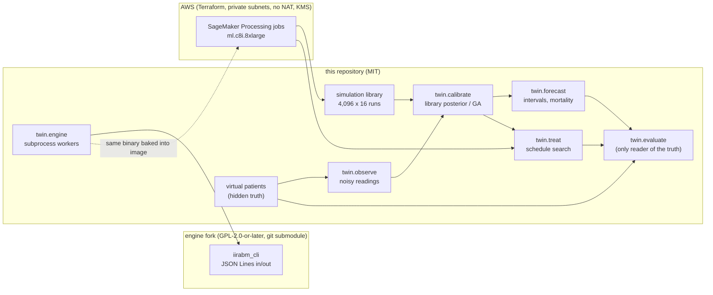

# A digital-twin loop on the IIRABM (measure, model, modulate)

A demonstration, in simulation where the true answer is known, of the loop that a medical digital twin
runs: **measure** noisy cytokine readings every 6 hours, **model** by calibrating a mechanistic immune
model to one patient with honest uncertainty, check the twin's forecasts against the hidden truth, then
**modulate**: search for a treatment schedule on the twin and score it on the true patient. The model
is the public Innate Immune Response Agent-Based Model (IIRABM; Cockrell and An, 2017). Simulations run
in parallel on Amazon SageMaker in a locked-down AWS account.

> **Research demonstration only.** A demonstration of method on a public 2017 model, with virtual
> patients. It does not reproduce, and says nothing about, the lab's current models, the ReSCUED twin,
> or real patient behaviour. The four "mediator interventions" only resemble approved drugs. No
> clinical claims. Everything below is "in this model".

## For reviewers

Honest verification and validation matter more here than impressive numbers. What to look at first:

<!-- headline:start -->
- **Engine.** Five defects in the 2017 code were confirmed with evidence and fixed (or documented).
  One changes results: at the model's default parameters, mortality at 28 days is
  73% with the original loop and 82% with the fix (200 seeds each). Running
  many simulations in one process (the original GA's pattern) changed the outcome far more:
  0 of 30 died in one process against 21 of 30 in fresh processes.
- **Twin.** On 100 held-out virtual patients, the 28-day mortality forecast has Brier score
  0.059 against 0.246 with no patient data (AUROC 0.98); 80% predictive intervals
  contain the truth 89% of the time. Only the injury size is clearly identified by
  readings up to 72 h.
- **Treatment.** A schedule searched on each patient's twin lowered mortality for the two (of five) patients
  whose fate was open, but **did no better than a single schedule for everyone**
  (paired difference +0.000, interval -0.037 to +0.037).
- **Cost.** About $33 of SageMaker jobs were itemised here (smoke and benchmark jobs, about $2, are
  not), on a $50 alarm.
<!-- headline:end -->

Where to read the evidence, in the order a sceptic would want it:

1. **The engine was fixed carefully, and the changes were measured** (not just made):
   [engine fork](https://github.com/bobvis1/iirabm) `docs/engine_changes.md`: five defects with
   AddressSanitizer evidence, a legacy build that reproduces the original output exactly, and the
   effect of each fix on outcomes.
2. **The truth is hidden from the twin, by test:** `tests/test_truth_isolation.py` walks the import
   graph; seed ranges never overlap (`tests/test_seeds.py`).
3. **Settings were chosen on a development cohort and frozen before the test cohort was scored once.**
   [docs/calibration.md](docs/calibration.md) records the tuning, including the selection rule that I
   **revised after the first run** because pooled coverage hid an overconfident parameter.
4. **Uncertainty is checked, not asserted:** [docs/validation_report.md](docs/validation_report.md) gives
   the empirical coverage of every interval, the prior-only baseline in every table, a measurement-design
   study, a misspecification stress test, and the leakage checks run when the test score looked too good.
5. **The treatment result is a null for personalisation:** [docs/treatment_report.md](docs/treatment_report.md);
   the protocol ([docs/treatment_protocol.md](docs/treatment_protocol.md)) was written before any result.
6. **Failures and fixes are recorded, not hidden:** a runner bug that dropped a table (recomputed and
   disclosed), a job that failed in 29 seconds, a duplicate launch rejected by an account limit. See the
   report footers and `PLAN.md`.
7. **Citations were checked against their sources:** [docs/references.md](docs/references.md).

## Architecture

The engine is run as a **separate program** through its command-line interface and is never linked into
Python, so this repository's MIT licence is not affected by the engine's GPL.

## How to reproduce each phase

Needs Python 3.11 with `uv`, Docker, and (for Phases 3 onward) an AWS account configured in
`config/settings.yaml` (copy `config/settings.example.yaml`). Run each step locally on a small sample
before running it on SageMaker. `ENGINE_DIR` defaults to the `engine/` submodule.

| Phase | What | How |
|---|---|---|
| 0 | Scaffold | `git clone --recurse-submodules ...; make test lint` |
| 1 | Engine: legacy baseline, fixes, CLI | in the fork: `tools/test_all.sh` (golden-file equivalence, sanitizers); `tools/measure_fixes.py`, `tools/measure_defect3.py` |
| 2 | Parameter space, patients, measurements | `engine/tools/ref.sh --platform linux/arm64 -- make cli`; `export IIRABM_BIN=scripts/iirabm_docker.sh`; `uv run python scripts/pilot.py`; `uv run python scripts/analyze_pilot.py`; `make cohort` |
| 3 | AWS, container, library | `scripts/infra.sh apply`; `scripts/push_image.sh`; `scripts/make_library_configs.py library --n 4096 --k 16 --shards 64 --upload`; `scripts/run_job.py library ...`; `scripts/analyze_library.py` |
| 4 | Calibration | `scripts/tune_calibration.py`; `scripts/make_ga_inputs.py`; `scripts/run_job.py ga-dev --module twin.jobs.calibrate_ga`; `scripts/tune_ga_delta.py` |
| 5 | Validation | `scripts/run_validation.py` (test cohort, once; needs the settings committed); `scripts/validation_diagnostics.py`; `scripts/render_validation.py` |
| 6 | Treatment | `scripts/select_treatment_patients.py`; `scripts/make_treatment_tasks.py`; `scripts/run_job.py ts-main --module twin.jobs.treat_search`; `scripts/score_treatment.py`; `scripts/render_treatment.py` |
| 7 | Docs | `scripts/render_results.py` fills the generated blocks of this file from `docs/results/*.json`; `scripts/teardown.sh` removes the AWS resources |

The raw outputs (library, GA fits, hidden truth, observations) are git-ignored and live under `data/`
and `truth/`; the small result files that this README quotes are under `docs/results/`.

## Results

Every number below is filled from a result file by `scripts/render_results.py`.

<!-- validation:start -->
### Validation (test cohort, 100 virtual patients, settings frozen before scoring)

In this model, with virtual patients drawn from the same model the twin assumes (a well-specified
setting, so near-nominal coverage is the expected result; see `docs/validation_report.md`):

| 28-day mortality forecast | Brier score | AUROC |
|---|---|---|
| prior only (no patient data) | 0.246 | 0.50 |
| library twin, theta-level | 0.059 [0.038, 0.084] | 0.98 |

Predictive intervals for oxy deficit and the cytokine panel contain the truth 63%
(50% interval), 89% (80%) and 98% (95%) of the time.
<!-- validation:end -->

<!-- treatment:start -->
### Treatment search (test patients, in this model)

**n is small and this is one 2017 model, not a clinical result.** For 5 test virtual patients
chosen by a rule fixed beforehand, a schedule of four mediator interventions (they only *resemble*
approved drugs) was searched on each patient's twin and scored on 64 fresh futures of the true
patient (fraction dead by day 28; `docs/treatment_report.md`). Pooled difference in mortality over the
5 patients: twin schedule minus no treatment -0.047 (95% interval -0.087 to -0.006); twin schedule minus the best
one-size-fits-all schedule +0.000 (95% interval -0.037 to +0.037); oracle (true parameters) minus no treatment
-0.072 (95% interval -0.109 to -0.034). Only two of the five patients had a fate treatment could change; the
twin-personalised schedule did no better than one-size-fits-all.
<!-- treatment:end -->

## Limits

- One 2017 model and virtual patients only. The twin is calibrated with the model that generated the
  data (an "inverse crime"); the misspecification test shows one way it degrades.
- Small cohorts: 100 test patients (40 for the GA), 5 for treatment, 64 futures each. Intervals are wide.
- The settings were tuned on 40 development patients and about 90 configurations; they are optimistic.
- Only the injury size is well identified by readings up to 72 hours; host resilience is not, although
  it matters most for the late outcome.
- The GA's parameter intervals under-cover; the library posterior is the reference method.
- Treatment: only two of the five chosen patients could benefit, the search objective is a proxy, and
  schedules found on a small ensemble overfit it. No claim is made about drugs or patients.

<!-- cost:start -->
### Cost

Engine throughput on SageMaker Processing instances (`docs/results/sagemaker_timing.json`):

| Instance | Workers | Steps per second | $ per hour | $ per million steps |
|---|---|---|---|---|
| `ml.c5.9xlarge` | 18 of 36 | 4,911 | $1.836 | $0.104 |
| `ml.c6i.8xlarge` | 16 of 32 | 6,127 | $1.632 | $0.074 |
| `ml.c7i.8xlarge` | 24 of 32 | 7,461 | $1.714 | $0.064 |
| `ml.c8i.8xlarge` | 24 of 32 | 9,398 | $1.799 | $0.053 |

AWS public price list AmazonSageMaker us-east-2 (2026-10-16); ml.c8i.8xlarge derived as 1/4 of ml.c8i.32xlarge (not listed). The engine is cache-bound: one worker per vCPU is slower overall than one
per physical core.

Simulation library: 4,096 design points x 16 seeds =
65,536 runs (214 million steps) on 4 x
`ml.c8i.8xlarge`, 91.5 minutes, about **$10.98**
(estimate from instance-hours; confirm in Cost Explorer, which lags about a day).

Actual cost from Cost Explorer, whole account since 2026-10-19, as of 2026-10-20T22:34+00:00: **$4.56**. Cost Explorer lags about a day, so this is incomplete until it is re-run (`scripts/cost_report.py`).
<!-- cost:end -->

## Licensing

- This repository (orchestration, analysis, infrastructure, docs) is MIT licensed; see
  [LICENSE](LICENSE).
- The simulation engine is a fork of IIRABM by Gary An and Chase Cockrell, licensed
  GPL-2.0-or-later. It is included as a git submodule at `engine/` and is not covered by this
  repository's licence. This repository runs the engine as a separate program through its command-line
  interface and does not link to it. Vendored `nlohmann/json` (MIT) is inside the fork.

## How this was built

The work was done with Claude Code under written rules (`CLAUDE.md`) and a plan (`PLAN.md`): phases
with acceptance criteria, a stop after every phase for review, tasks that need a human marked as such,
and rules such as "the truth is hidden", "seed ranges never overlap", "nothing is tuned on test
patients", "uncertainty claims are checked", "a result that looks too good is suspected before it is
reported", and "ask before committing and point out any cut explicitly". Where the plan was wrong
(simulation was several times slower and cache-bound on SageMaker; a selection rule hid an
overconfident parameter; a runner dropped a table), the departure and the reason are recorded in
`PLAN.md`, the reports and the commit messages.
